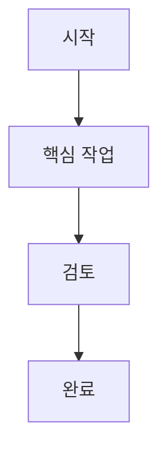

## 0. 공통 실행 원칙

- 이 스킬은 `obsidian-cli-guideline` 기준을 따른다.
- Mermaid 코드는 markdown 파일 본문에 직접 작성한다.
- 렌더링 확인이 필요하면 수정 후 Obsidian 앱에서 해당 노트를 열어 본다.

## 1. 목표

글만 쓰지 말고, 항상 `설명 + Mermaid 다이어그램`을 같이 만든다.

## 1.1 입력 계약

- 필수:
  - `topic`
  - `note_path` 또는 기존 노트 본문
- 선택:
  - `diagram_type`

## 1.2 출력 계약

- 결과:
  - 설명 문단
  - `mermaid` 코드블록 1개 이상
  - 짧은 요약
- 파일 수정 시:
  - 지정한 markdown 노트에 직접 반영

## 2. 가장 쉬운 규칙 (핵심)

1. 먼저 핵심 내용 3~7개를 뽑는다.
2. 내용 성격에 맞는 Mermaid 종류 1개를 고른다.
3. 다이어그램 코드블록과 3줄 설명을 같이 적는다.

## 3. Mermaid 종류 고르기

- 순서/절차 설명: `flowchart`
- 사람/시스템 대화 흐름: `sequenceDiagram`
- 아이디어 가지치기: `mindmap`
- 일정/마일스톤: `gantt`

## 4. 작성 절차 (고정 루틴)

1. 노트 주제를 1문장으로 쓴다.
2. 핵심 노드(개념) 이름을 짧게 만든다.
3. 노드 연결(원인->결과, 단계1->단계2)을 정한다.
4. 아래 템플릿으로 Mermaid 블록을 작성한다.
5. 다이어그램 아래에 `요약 3줄`을 적는다.
6. 필요하면 Obsidian에서 렌더링 모드로 열어 깨진 Mermaid가 없는지 확인한다.

## 5. 기본 템플릿

````markdown
## 시각화



## 요약
- 이 흐름은 시작부터 완료까지 4단계를 보여준다.
- 핵심 작업 후 검토 단계를 반드시 거친다.
- 문제 발생 시 검토 단계에서 원인을 확인한다.
```
````

## 6. 품질 체크리스트

- [ ] 노드 이름이 짧고 이해하기 쉬운가?
- [ ] 화살표 방향이 실제 흐름과 맞는가?
- [ ] 다이어그램과 텍스트 요약이 같은 내용을 말하는가?
- [ ] Mermaid 문법 오류가 없는가?

## 6.1 실패 시 처리

- 구조가 너무 복잡하면 한 장에 다 넣지 말고 다이어그램을 2개로 나눈다.
- 확실한 흐름을 모르겠으면 `flowchart`보다 `mindmap`을 우선 고려한다.

## 7. 자주 쓰는 빠른 예시


