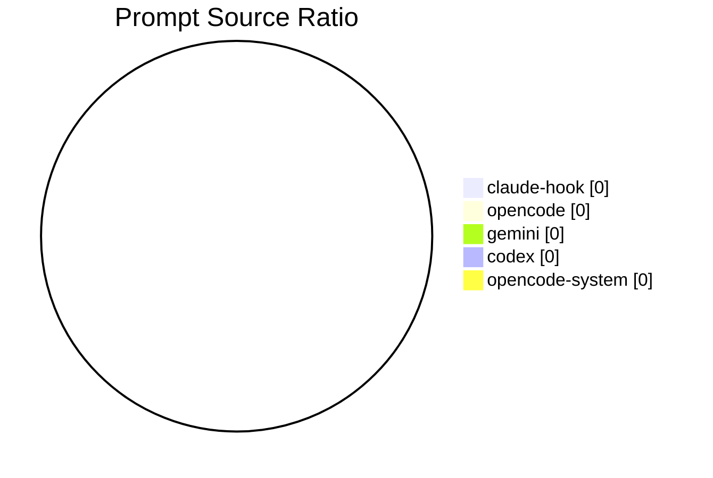

## 0. 공통 실행 원칙

- 이 스킬은 `obsidian-cli-guideline` 기준을 따른다.
- 읽는 `prompt/history/...` 와 쓰는 `prompt/review/...` 는 모두 `OBSIDIAN_ROOT` 기준 경로다.
- 현재 코드 프로젝트 `cwd`와 무관하게 vault 내부 문서만 다룬다.
- 분석은 `prompt/history/*.md` 파일을 직접 읽어서 수행한다.
- `source=` 메타데이터가 있으면 이를 우선 신뢰한다.
- `source=`가 없더라도 프롬프트 본문 패턴으로 출처를 추정하되, 추정값은 명시적으로 `추정`이라고 적는다.
- 결과 문서는 markdown 파일로 만들고, 필요할 때만 Obsidian 앱에서 `prompt/review` 노트를 열어 검토한다.

## 1. 목표

`prompt/history`에 쌓인 프롬프트 기록을 기반으로 사용자 사용 패턴과 출처별 사용 비율을 분석하고,
더 좋은 프롬프트 작성 방식과 작업 운영 개선점을 제시하는 회고 결과를 만든다.

- 입력: 기간, 분석 대상 에이전트(source), 최소 빈도 기준
- 출력: 출처 분석 + 패턴 분석 + 프롬프트 개선 가이드 + 운영 개선안 + (선택) 스킬/서브에이전트 제안

## 1.1 전역 경로 기준

- 프로젝트 루트: `$OBSIDIAN_ROOT`
- 프롬프트 로그: `$OBSIDIAN_ROOT/prompt/history/YYYY-MM-DD.md`

## 2. 분석 입력

- 분석 기간: 최근 N일 또는 시작일/종료일
- 에이전트 범위: `codex-notify`, `codex-global`, `codex-jsonl`, `claude-hook`, `gemini`, `opencode`, `all`
- 최소 반복 기준(권장): 주 3회 이상 또는 전체의 10% 이상

## 2.1 입력 계약

- 필수:
  - `period`
- 선택:
  - `source`
  - `min_frequency`
  - `output_file`

출력 파일이 없으면:

- 응답 본문만 만들고, 사용자가 원할 때만 `prompt/review/`에 저장한다.

## 2.2 출력 계약

- 결과물:
  - 패턴 분석
  - 프롬프트 개선 제안
  - 운영 개선안
  - 선택적 스킬/서브에이전트 제안
- 파일 저장 시 기본 위치:
  - `$OBSIDIAN_ROOT/prompt/review/YYYY-MM-DD.md`

## 3. 표준 절차

1. 기간에 해당하는 `prompt/history/*.md` 파일 목록을 확정한다.
2. 프롬프트를 의도 단위로 정규화한다.
3. source를 먼저 확정한다.
   - 명시값: `source=...`
   - 추정값: `opencode` / `opencode-system` / `claude-hook`
4. `opencode-system` 항목은 별도 집계하되, 사용자 실질 프롬프트 통계에서는 분리한다.
5. 아래 축으로 패턴을 군집화한다.
   - 작업 유형: 분석/구현/리뷰/운영/동기화
   - 실행 성격: 단발/반복/파이프라인
   - 난이도: 단순 명령/다단계 절차/고위험 변경
6. 출처별 빈도와 비율을 계산한다.
   - raw 총량
   - 실질 사용자 프롬프트 수
   - source별 건수
   - source별 비율
7. 반복 빈도와 실패 신호를 계산한다.
   - 반복 요청
   - 같은 질문의 재질문
   - 경로/설정/권한 관련 재시도
8. 프롬프트 품질 개선 포인트를 도출한다.
   - 요청 목적/제약/완료조건 누락 패턴
   - 모호 표현/재질문 유발 표현
   - 명령형 구조 개선 가능 구간
9. 개선 템플릿을 만든다.
   - "목표 + 맥락 + 제약 + 완료조건 + 출력형식" 구조로 재작성 예시
10. 스킬화/서브에이전트 분리 후보를 하위 제안으로 도출한다.
11. 전체 제안을 우선순위화해 실행 계획으로 정리한다.
12. 결과를 저장했다면 Obsidian에서 해당 review 노트를 열어 위키링크, 표, mermaid 렌더링을 확인한다.

## 4. 분리 판단 기준

- 스킬 후보:
  - 입력/출력이 비교적 고정적이고 절차 재사용성이 높음
  - 파일 경로/명령/템플릿이 명확함
- 서브에이전트 후보:
  - 여러 스킬 조합이 필요하거나 의사결정/조율 역할이 큼
  - 실패 복구/분기 처리/우선순위 판단이 빈번함
- 즉시 자동화 제외:
  - 민감 정보 노출 위험이 높은 흐름
  - 요청 맥락 의존성이 매우 커 오탐 위험이 큰 흐름

## 5. 출력 형식

```markdown
## 에이전트 사용 리뷰

### 1) 요약
- 분석 기간:
- 총 프롬프트 수(raw):
- 실질 사용자 프롬프트 수:
- 상위 작업군 TOP 5:

### 2) 출처 분석
- 명시 source 통계:
- 추정 source 통계:
- source별 특징:



### 3) 패턴 분석
- 반복 패턴:
- 실패/재시도 패턴:
- 병목 구간:

### 4) 프롬프트 개선 회고
- 자주 나타나는 문제 패턴:
- 개선 원칙:
- 개선 전/후 예시:

### 5) 운영 개선 제안
- 즉시 적용 규칙(Quick wins):
- 재발 방지 규칙:
- 체크리스트:

### 6) 스킬/서브에이전트 제안 (선택)
#### 6-1) 스킬 분리 제안
| 우선순위 | 후보명 | 근거(빈도/재사용성) | 예상 효과 | 리스크 |
|---|---|---|---|---|
| P1 |  |  |  |  |

#### 6-2) 서브에이전트 분리 제안
| 우선순위 | 역할 | 담당 범위 | 입력/출력 계약 | 연계 스킬 |
|---|---|---|---|---|
| P1 |  |  |  |  |

### 7) 2주 실행 계획
- Week 1:
- Week 2:
- 측정 지표(KPI):

### 8) 근거 파일
- [[prompt/history/YYYY-MM-DD]]
- 원본 스킬: `$AUSTIN_WORKSPACE_KIT_ROOT/skills/obsidian-review-agent-usage/SKILL.md`
```

## 6. 리뷰 규칙

- 근거 없는 추정 제안은 제외한다.
- source 추정이 개입되면 "명시"와 "추정"을 분리해 적는다.
- 빈도만 보지 말고 실패/재시도 비용을 함께 반영한다.
- 프롬프트 개선 제안은 반드시 "재작성 예시"를 포함한다.
- 근거 파일 링크는 항상 Obsidian 위키링크(`[[vault/relative/path]]`)로 작성한다.
- 제안마다 "왜 지금 분리해야 하는지"를 1문장으로 명시한다.
- 결과는 실행 가능한 단위(P1/P2/P3)로 제한한다.
- 머메이드는 최소 1개 포함한다.
  - 기본값: source 비율 `pie`
  - 필요 시 추가: source -> 작업군 대응 `flowchart`

## 6.1 실패 시 처리

- 로그 파일 수가 너무 적으면 과한 일반화를 하지 않는다.
- source별 구분이 애매하면 `all` 기준 분석으로 낮춰서 설명한다.
- `opencode-system` 항목은 노이즈 통계로만 두고, 사용자 프롬프트 품질 판단에는 섞지 않는다.

## 6.2 빠른 실행 예시

```text
입력:
- period: 최근 7일
- source: all
- min_frequency: 주 3회
```

## 7. 완료 체크리스트

- [ ] 분석 기간과 대상 source가 명시되었는가?
- [ ] 출처(source)별 건수와 비율이 포함되었는가?
- [ ] 반복 패턴/실패 패턴이 수치 또는 사례로 제시되었는가?
- [ ] 프롬프트 개선 원칙과 재작성 예시가 포함되었는가?
- [ ] 운영 개선 규칙(quick wins + 재발 방지)이 포함되었는가?
- [ ] mermaid 차트가 최소 1개 포함되었는가?
- [ ] 스킬/서브에이전트 제안은 선택 항목으로 정리되었는가?
- [ ] 2주 내 실행 가능한 계획과 KPI가 포함되었는가?
